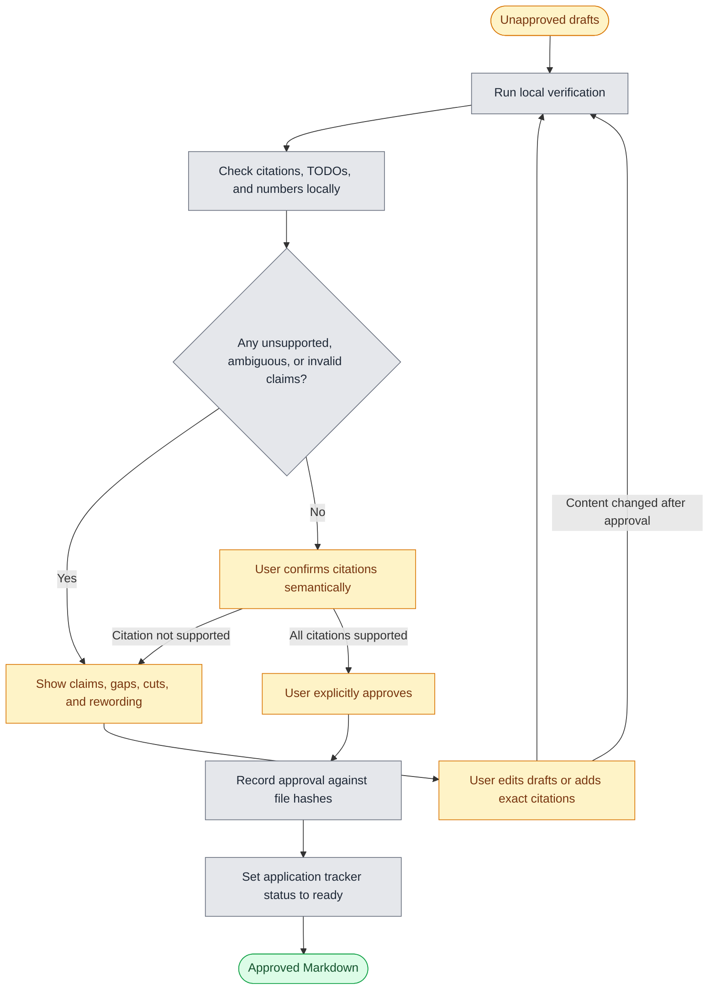
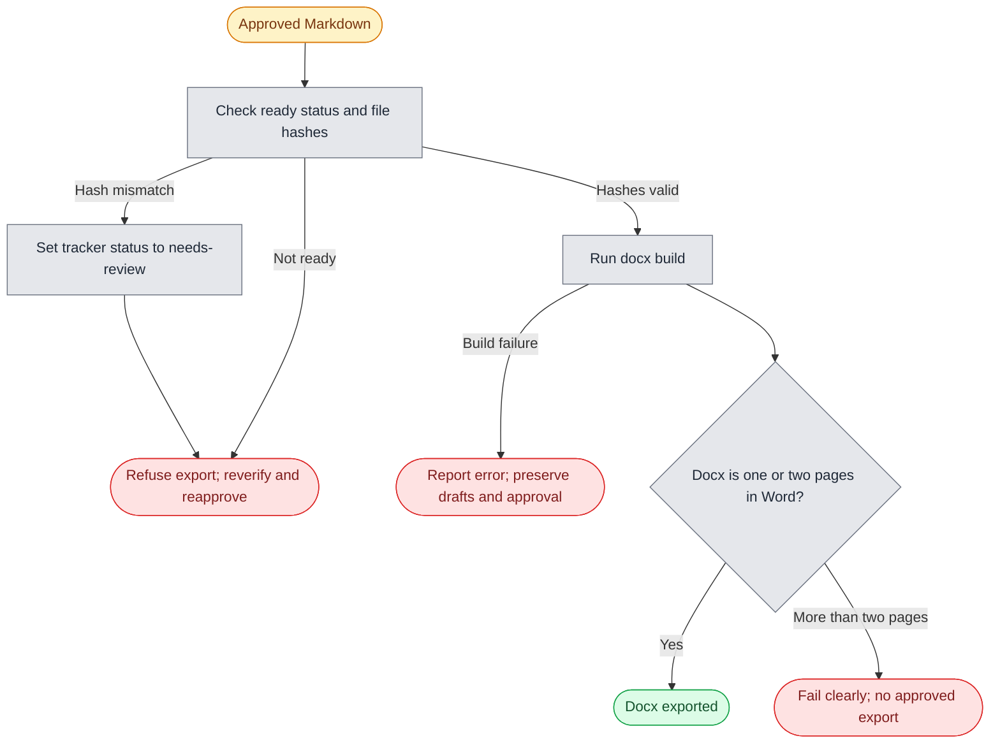

# PRD: Application Pipeline (Lean MVP)

**Status:** Draft | **Author:** Carrie | **Parent:** [README.md](../README.md), [AGENTS.md](../AGENTS.md)

## Overview

Manual tailoring takes a self-reported 30-60 minutes per application (sometimes a full day). This turns it into a local CLI workflow: provide a job description, generate editable resume and cover-letter drafts, verify claims, approve the Markdown, export a .docx. Drafts stay unapproved until the user reviews and marks them ready. Export and submission are separate manual steps. Batch processing waits for the single-application reliability pilot.

## Problem Statement

Carrie is a recent graduate applying to graduate programs, internships, part-time work, software development and UX design roles. Each needs different tailoring. Perfectionism can turn one application into a full day and cause missed deadlines; for less compelling roles, the effort can lead to a generic resume. She has a strong master resume but 20+ draft versions in one folder and cannot tell which is latest. She dislikes writing and wants to delegate, but will not accept generic text or unsupported claims.

The 30-60 minute and full-day durations and the 20+ draft count are self-reported, as are the missed deadlines and generic submissions.

## Goals & Success Metrics

| Metric                                                         | Baseline                                                 | Target                                       | Timeframe |
| -------------------------------------------------------------- | -------------------------------------------------------- | -------------------------------------------- | --------- |
| Median elapsed time from application intake to approved drafts | Manual workflow: self-reported estimate of 30-60 minutes | Set after the first three pilot applications | Pilot     |
| Unsupported claims in final approved output                    | n/a                                                      | 0                                            | Always    |
| Successful docx build                                          | n/a                                                      | 100%                                         | Always    |
| Explicit human approval recorded before `ready`                | n/a                                                      | 100%                                         | Always    |

Record intake and approval timestamps for each pilot application; use the first three to set a time-reduction target for subsequent applications.

### Guardrail metrics

- No private content from master sections 6-10 is sent to the model or copied into application output.
- Every factual claim in final output is mapped to an exact supporting master line; metric claims are checked locally against section 6 and use its safe wording where applicable, and other numbers are checked against their cited lines.
- Unapproved drafts may contain claims flagged by verification; none may remain unsupported in the final approved output.

## Persona

**Carrie, recent graduate and solo job seeker.** Comfortable with a terminal and git, dislikes writing, perfectionistic about quality. Has built custom agent skills and templates for tailoring and wants AI to follow them without sounding generic. Wants editable drafts to review, delegates as much as possible, and will not approve a claim she cannot defend in an interview.

## Scope

### In Scope (V1)

A local CLI wrapper around the existing scripts and a configurable OpenAI-compatible API for an open-weight model. The API is used for tag suggestions and draft generation, not as the final verifier. No web app or database in V1. The specific model and endpoint may be selected later.

### Non-Goals (V1)

- Automated form submission or browser automation on job boards.
- Web app, accounts, multi-user, hosting.
- Job scraping or discovery/search feeds.
- Batch processing; reconsider only after the single-application reliability pilot passes.
- Interview prep generation (existing skill, run manually).
- Auto-learning from outcomes.
- Recruiter response-rate analytics as a V1 success measure.

## Functional Requirements

- **FR1: Intake.** `apply <company-role> [--jd FILE]` calls `scripts/new-application.sh` (which also creates `notes.md` and an empty `cover-letter.md`) and saves the job description to `applications/<YYYY-MM-company-role>/job-description.md`. If `--jd` is omitted, prompt for pasted text. V1 also accepts a local JD file; URL fetching is deferred.
- **FR2: Role-family selection.** In one generation request, the model receives the job description and user-approved public-safe fact allowlist, recommends tags from the README tag list, and returns initial resume and cover-letter drafts. The CLI shows the proposed tags; the user can change them and regenerate with the confirmed tags. The confirmed tags are recorded with the application.
- **FR3: Tailor.** The model tailors the resume per `AGENTS.md` and `.claude/skills/resume-drafter`: 5-7 bullets per role family, keywords mirrored only where the master supports them, Australian English, and no tag names in output. It writes an unapproved `resume.md` in the application folder and never touches `master/`.
- **FR4: Cover letter.** The model returns an unapproved `cover-letter.md` per `.claude/skills/cover-letter-generator`, using only the approved public-safe facts and job description.
- **FR5: Verify (approval gate).** Each factual claim in the resume and cover letter must cite an exact supporting line from master sections 1-5 in a sidecar `verify-report.md`. The report lists supported claims, unsupported claims, TODO items, and citations. Local code validates that cited lines exist and checks metric claims against the section 6 metrics log, applying its safe wording where required; section 6 is used locally only, and its contents are never sent to the API. Other numbers must be supported by their cited master line. The user confirms that each citation semantically supports its claim. Ambiguous or uncited claims count as unsupported and block `ready`. A user may resolve a verifier false positive only by supplying an exact supporting master-line citation; genuinely unsupported claims cannot be overridden.
- **FR6: Review and approval.** Generated Markdown is unapproved and editable. The CLI displays what was cut, what was reworded, gaps, and every claim still needing evidence. After any edits, verification must run against the exact current Markdown. The user explicitly approves in the CLI; only then is the application's row in `tracker.csv` set to `ready`. Whenever a CLI command relies on `ready` or exports approved content, it compares the current Markdown hashes with the approval manifest. A mismatch changes the tracker status to `needs-review` and blocks the operation until verification and approval are repeated.
- **FR7: docx export.** A separate CLI command exports approved Markdown via `scripts/build.sh applications/<folder>/resume.md` (`build.sh` builds the `.docx` and fills `${RESUME_*}` contact placeholders from `.env`). One page is the target; up to two pages are allowed when needed to preserve relevant, supported evidence. Page count is checked manually in Word, because a `.docx` has no fixed page count. Docx export is not required to mark the Markdown `ready`, and submission remains manual.
- **FR8: Regeneration and failures.** Regeneration creates a separate revision and preserves all existing drafts, including user-edited drafts; the user chooses which version to keep. On model, verification, or export failure, stop that operation with a clear error, preserve the JD and existing drafts, and never mark unsupported or unapproved content ready.

## Main User Flows

The diagrams below show the V1 happy paths and the main negative paths or recovery loops. A failed operation preserves the JD and existing drafts; it does not create an approved result.

**Diagram legend:** blue = AI agent, grey = local CLI/system, yellow = manual user action or review, green = successful outcome, red = stop or failure.

### Flow 1: Intake and draft generation


### Flow 2: Verification, review, and approval



### Flow 3: Approved Markdown to docx



### Flow 4: Regeneration and failure recovery


## Non-Functional Requirements

- **Privacy:** The model receives only the job description and a reusable, user-approved public-safe fact allowlist curated from master sections 1-5. It never receives the full master resume or content from sections 6-10. The section 6 metrics log stays local for metric checks and application of any required safe wording. Use generic wording for Outlier / Scale AI work unless the user confirms otherwise. Before each API call, show the complete outbound request payload, including the JD and approved facts. Before the first live call, review the selected provider's request handling and data-retention terms. Keep credentials out of application artifacts and Git.
- **Provider interface:** Use a configurable OpenAI-compatible API for an open-weight model. Read credentials from a local ignored `.env` file, with environment variables taking precedence. `.env` already holds the `RESUME_NAME/EMAIL/PHONE/LINKS` contact values read by `build.sh`; API settings must use separate variable names, and agents must not read or write `.env` (see `AGENTS.md`). Record the endpoint/provider and model used, but do not log prompts or secrets.
- **Cost:** Track estimated/actual cost per application. If an estimate exceeds USD 0.50, ask the user before making the call; this is a consent threshold, not an automatic hard stop.
- **Latency:** Under 3 minutes per application, excluding human review, is a non-blocking operational target.
- **Idempotent:** Never overwrite an existing draft on regeneration; create a separate revision.
- **Auditable:** Application artifacts live in git per application folder, with model name and date in `notes.md`. Approval is recorded against hashes of the exact verified Markdown files. Whenever the CLI relies on approval, it checks those hashes; a mismatch sets the application's tracker status to `needs-review`.

## Architecture (lean)

Local CLI modular monolith: a small Python orchestrator, no services.

```
CLI intake
    -> existing application-folder script
    -> configurable OpenAI-compatible API (tag suggestions + draft generation)
    -> local citation/number checks + human semantic review
    -> explicit CLI approval bound to verified-file hashes -> tracker.csv (`ready`)
    -> separate docx export via existing build.sh; page count checked manually in Word
```

Choices and reasons:

- **Reuse first:** `new-application.sh`, `build.sh`, `.claude/skills/*` and `tracker.csv` already exist. Keep the shell scripts as the folder-setup and docx-export layer; the CLI orchestrates them rather than reimplementing them.
- **Language:** Python 3 for the orchestrator and verification workflow. Prefer the standard library for CLI parsing, filesystem operations, subprocess calls, CSV/JSON, hashing and HTTP requests; add dependencies only where they materially simplify the implementation. Keep the code in a few focused modules for intake/orchestration, provider interaction, verification and approval instead of growing one script. Continue to run the existing Bash scripts through Git Bash.
- **Provider compatibility:** Keep the endpoint and model configurable, but do not assume every OpenAI-compatible provider supports identical request parameters or response formats. Validate responses and fail clearly on unsupported or malformed responses. The model proposes tags and drafts; it cannot satisfy the local verification or approval gate.
- **Local verification:** validate citations against master lines, check metric claims against the section 6 metrics log, and check other numbers against their cited lines. The model may propose source references, but only the local checks and user's semantic review can satisfy the approval gate.
- **State:** application files, a small per-application approval manifest, and `tracker.csv`. Bind approval to hashes of the verified resume and cover letter; check them before accepting or exporting an approved version. No database until there is a demonstrated need.
- **Reversibility:** drafts and reports remain plain Markdown; provider settings stay configurable and approval metadata stays local. This keeps swapping the model or orchestrator low-cost.

## Edge Cases

| Case                                                | Expected behaviour                                                                                                                                              |
| --------------------------------------------------- | --------------------------------------------------------------------------------------------------------------------------------------------------------------- |
| JD asks for a skill not in master                   | Omit; list under "gaps" in the review summary. Never add it.                                                                                                    |
| User changes tags after model suggestion            | Regenerate using the confirmed tags; preserve earlier draft revisions.                                                                                          |
| Resume exceeds one page                             | Target one page; preserve relevant supported evidence up to two pages; fail clearly above two pages.                                                            |
| Master field marked `TODO`                          | Flag in the report; leave out of the output.                                                                                                                    |
| Metric marked Estimate / Projection / Self-reported | Use safe wording from section 6.                                                                                                                                |
| Duplicate company-role in same month                | `new-application.sh` exits with "Already exists"; the CLI stops, creates nothing and preserves the existing folder. Use a different name.                       |
| User edits output after verification or approval    | At the next CLI check that relies on approval, compare file hashes; on mismatch, set tracker status to `needs-review` and require re-verification and approval. |
| Cost estimate exceeds USD 0.50                      | Show the estimate and wait for explicit user confirmation before the API call.                                                                                  |
| Model, verifier, or docx export fails               | Report the error, preserve the JD and drafts, and do not mark ready.                                                                                            |

## Acceptance Criteria

- [ ] Given a local JD file, when I run `apply acme-frontend --jd jd.md`, then the application folder contains the JD and unapproved Markdown drafts plus a claim-verification report; no docx is exported before approval.
- [ ] Given a metric claim absent from section 6, when local verification runs, then `ready` is blocked and the claim is named; given another number, verification checks that its cited master line supports it.
- [ ] Given a factual claim without an exact supporting master-line citation, then it is listed as unsupported and blocks approval.
- [ ] Given a citation to a master line, then local code confirms that the line exists and the user confirms that it semantically supports the claim.
- [ ] Given a JD requiring a skill absent from master, then it is absent from the resume and listed as a gap.
- [ ] Given any generated output, then it contains no tag names and no private content from master sections 6-10.
- [ ] Given a job, then the complete outbound request payload (job description and user-approved public-safe facts) is shown before the API call, with private sections 6-10 never sent; the selected provider's request handling and data-retention terms are reviewed before the first live call.
- [ ] Given an approved draft, then the user can export a .docx separately; the user confirms it is one or two pages in Word.
- [ ] Given any approval-dependent operation on Markdown whose contents no longer match the approval manifest, then the CLI sets tracker status to `needs-review` and refuses to treat it as `ready` or export it as approved until it is reverified and reapproved.
- [ ] Given regeneration, then a new revision is created without overwriting prior or user-edited drafts.
- [ ] Given explicit approval of the verified Markdown, then the application's row in `tracker.csv` has status `ready`.
- [ ] Given an estimated cost above USD 0.50, then the API call waits for user confirmation.
- [ ] `tests/` gains tests using synthetic fixtures only (number check, outbound payload excludes sections 6-10, approval-hash mismatch), run by a new step in `.github/workflows/tests.yml`. Removal of sections 6-10 from `build.sh` output is already covered by `tests/test-build.sh`.

## Rollout Plan

1. **Pilot:** single-application flow, local checks, CLI approval state, separate docx export. Track failures on real applications.
2. **Reliability gate:** after 10 consecutive applications with zero unsupported claims in approved output, successful builds and recorded approval, add batch.
3. **Batch:** `apply-batch jobs.txt`, sequential, continues after item failures, builds a review queue, never auto-approves.

## Later Phases (not committed)

- **Future, assisted submit:** a script that opens the application page and pre-fills fields using `.claude/skills/application-form-filler`, with the user clicking submit. Assess job-board terms and account risk before implementation; full autopilot is not a goal.
- **Future, web app:** only if the CLI is the bottleneck. A local review/export UI over the same folder structure; hosting would mean resume data leaves the machine and would require a separate privacy decision.
- **Job feed:** saved-search email alerts parsed into `jobs.txt`, still reviewed by hand.

## Risks & Open Questions

| Risk / Question                                                | Severity | Mitigation                                                                                                                                        | Status  |
| -------------------------------------------------------------- | -------- | ------------------------------------------------------------------------------------------------------------------------------------------------- | ------- |
| LLM fabricates or inflates claims                              | High     | FR5 gate, deterministic number check, human approval                                                                                              | Open    |
| Model API receives content not approved for external use       | High     | Send only the reusable, user-approved public-safe fact allowlist and displayed JD payload; never send sections 6-10                               | Open    |
| Cost exceeds expected USD 0.50 per application                 | Low      | Ask for confirmation when estimated cost exceeds the threshold; track usage                                                                       | Open    |
| Auto-apply violates job board terms                            | High     | Non-goal in V1; assisted submit only                                                                                                              | Decided |
| Specific open-weight model and API endpoint                    | Low      | Keep the endpoint/model configurable; choose before implementation or first live run                                                              | Open    |
| Provider compatibility or retention terms differ               | Medium   | Validate the selected provider's request/response behaviour and data-retention terms before first live use; fail clearly on unsupported responses | Open    |
| Whether tailored applications improve recruiter response rates | Medium   | Defer outcome analytics; decide whether to track callbacks after the core workflow is proven                                                      | Open    |

## Assumptions Made

- Solo user, Windows with Git Bash, Python 3 is available for the CLI, and existing Bash scripts remain the setup/build layer.
- The existing skills are good enough to start; tuning them comes after measurement.
- The CLI is the V1 interface; docx export is a separate command after content approval.
- Any future daily-volume target refers to prepared applications, with submission done by hand.
