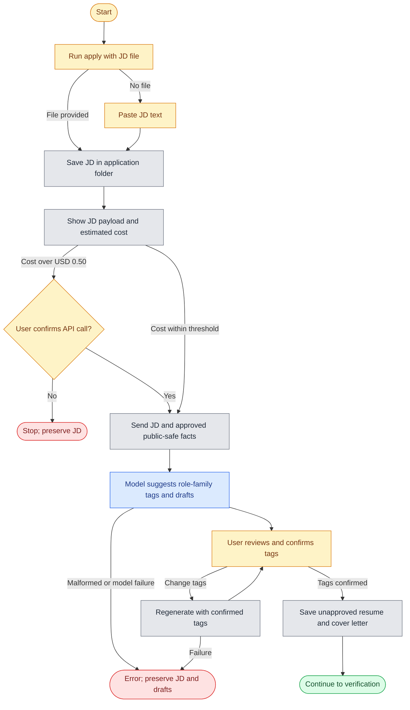
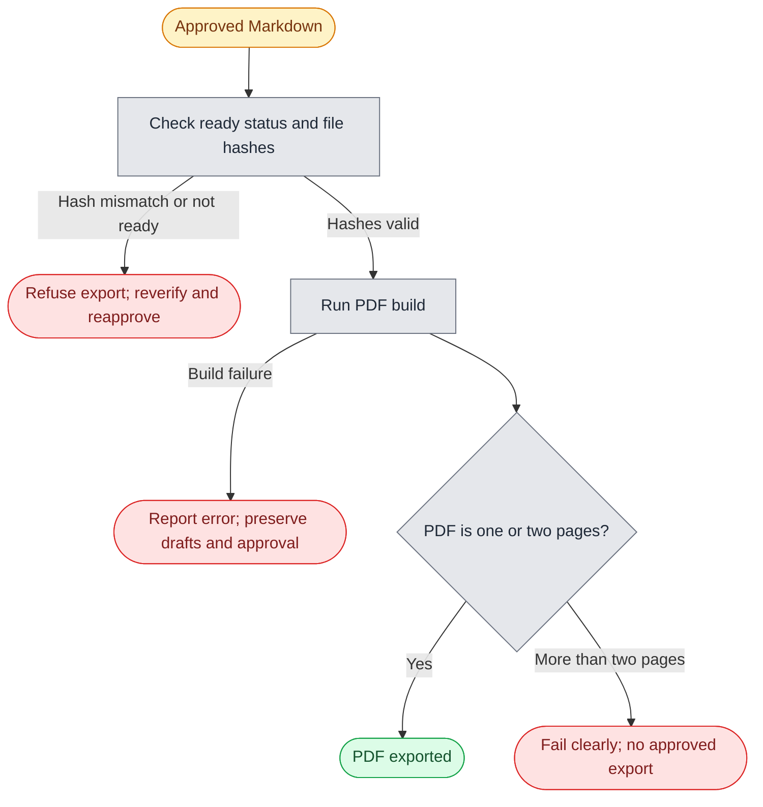
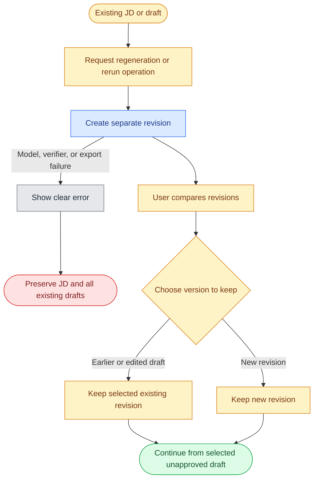

# PRD: Application Pipeline (Lean MVP)

**Status:** Draft | **Author:** Carrie | **Parent:** [README.md](./README.md), [AGENTS.md](./AGENTS.md)

## Overview

Tailoring a resume and cover letter for each job takes 30-60 minutes by hand, and a high-priority application can take a full day. This MVP turns that into a local CLI workflow: provide a job description, generate editable resume and cover-letter drafts, verify their claims, approve the final Markdown, and export a styled PDF. Drafts are unapproved until the user edits/reviews them and explicitly marks them ready. PDF export and job submission are separate manual steps. Batch processing is deferred until the single-application workflow passes its reliability pilot.

## Problem Statement

Carrie is a recent graduate applying to multiple graduate programs and internships in a tough, competitive job market, as well as roles ranging from part-time work to software development and UX design. Each application requires different tailoring. The manual workflow takes 30-60 minutes, but for a job she particularly wants, perfectionism can lead her to spend the whole day on a single application. As a result, she can miss opportunities when tailoring runs past an application deadline. For roles that feel less compelling, the effort required to tailor can instead lead her to submit a generic resume.

While studying and working on personal projects, Carrie has limited time for applications. She strongly dislikes writing but is a perfectionist about application quality. She has a high-quality master resume she wrote herself, yet has accumulated 20+ resume-version drafts in one disorganised folder and is afraid to delete any because she cannot tell which is the latest. Each rejection after substantial effort is especially discouraging. She would rather delegate the application work, but generic-sounding materials or unsupported claims are not acceptable to her.

## Goals & Success Metrics

| Metric | Baseline | Target | Timeframe |
|---|---|---|---|
| Unsupported claims in final approved output | n/a | 0 | Always |
| Successful PDF build within page limit | n/a | 100% | Always |
| Explicit human approval recorded before `ready` | n/a | 100% | Always |

### Guardrail metrics

- No private content from master sections 6-10 is sent to the model or copied into application output.
- Every factual claim in final output is mapped to an exact supporting master line; numbers are checked locally against section 6 and use its safe wording where applicable.
- Unapproved drafts may contain claims flagged by verification; none may remain unsupported in the final approved output.

## Persona

**Carrie, recent graduate and solo job seeker** applying to graduate programs, internships, part-time jobs, software development roles, and UX design roles in a tough, competitive job market. She is studying and working on personal projects, is comfortable with a terminal and git, and strongly dislikes writing. She has a high-quality master resume that she wrote herself, but also has 20+ resume-version drafts in a disorganised folder and cannot confidently identify the latest. She has researched and built custom agent skills and templates for tailoring applications. She wants AI to follow that approach and tailor or edit her existing material without making it sound generic. She is perfectionistic about quality, wants editable drafts she can review and correct, would rather delegate as much application work as possible, and will not approve anything containing a claim she cannot defend in an interview.

## Scope

### In Scope (V1)

A local CLI wrapper around the existing scripts and a configurable OpenAI-compatible API for an open-weight model. The API is used for tag suggestions and draft generation, not as the final verifier. No web app or database in V1. The specific model and endpoint may be selected later.

### Non-Goals (V1)

- Automated form submission or browser automation on job boards.
- Web app, accounts, multi-user, hosting.
- Job scraping or discovery/search feeds.
- Batch processing until the single-application reliability pilot passes.
- Interview prep generation (existing skill, run manually).
- Auto-learning from outcomes.
- Recruiter response-rate analytics as a V1 success measure.

## Functional Requirements

- **FR1: Intake.** `apply <company-role> [--jd FILE]` calls `scripts/new-application.sh` and saves the job description to `applications/<YYYY-MM-company-role>/job-description.md`. If `--jd` is omitted, prompt for pasted text. V1 also accepts a local JD file; URL fetching is deferred.
- **FR2: Role-family selection.** In one generation request, the model receives the job description and user-approved public-safe fact allowlist, recommends tags from the README tag list, and returns initial resume and cover-letter drafts. The CLI shows the proposed tags; the user can change them and regenerate with the confirmed tags. The confirmed tags are recorded with the application.
- **FR3: Tailor.** The model tailors the resume per `AGENTS.md` and `skills/resume-tailor-quick`: 5-7 bullets per role family, keywords mirrored only where the master supports them, Australian English, and no tag names in output. It writes an unapproved `resume.md` in the application folder and never touches `master/`.
- **FR4: Cover letter.** The model returns an unapproved `cover-letter.md` per `skills/cover-letter-generator`, using only the approved public-safe facts and job description.
- **FR5: Verify (approval gate).** Each factual claim in the resume and cover letter must cite an exact supporting line from master sections 1-5 in a sidecar `verify-report.md`. The report lists supported claims, unsupported claims, TODO items, and citations. Local code validates that cited lines exist and checks numbers against the section 6 metrics log; section 6 is used locally only, and its contents are never sent to the API. The user confirms that each citation semantically supports its claim. Ambiguous or uncited claims count as unsupported and block `ready`. A user may resolve a verifier false positive only by supplying an exact supporting master-line citation; genuinely unsupported claims cannot be overridden.
- **FR6: Review and approval.** Generated Markdown is unapproved and editable. The CLI displays what was cut, what was reworded, gaps, and every claim still needing evidence. After any edits, verification must run against the exact current Markdown. The user explicitly approves in the CLI; only then is a row appended to `tracker.csv` with status `ready`. If approved content changes, `ready` is revoked and verification and approval must be repeated.
- **FR7: PDF export.** A separate CLI command exports approved Markdown via `scripts/build.sh applications/<folder>/resume.md`. One page is the target; up to two pages are allowed when needed to preserve relevant, supported evidence. Export fails above two pages. PDF export is not required to mark the Markdown `ready`, and submission remains manual.
- **FR8: Regeneration and failures.** Regeneration creates a separate revision and preserves all existing drafts, including user-edited drafts; the user chooses which version to keep. On model, verification, or export failure, stop that operation with a clear error, preserve the JD and existing drafts, and never mark unsupported or unapproved content ready.
- **FR9: Batch (later phase).** Add `apply-batch jobs.txt` only after the single-run reliability pilot passes: at least 10 consecutive applications with zero unsupported claims in final approved outputs, successful builds, and explicit human approval records. Batch runs sequentially, continues after item failures, and creates a review queue; it never auto-approves.

## Main User Flows

The diagrams below show the V1 happy paths and the main negative paths or recovery loops. A failed operation preserves the JD and existing drafts; it does not create an approved result.

**Diagram legend:** blue = AI agent, grey = local CLI/system, yellow = manual user action or review, green = successful outcome, red = stop or failure.

### Flow 1: Intake and draft generation



### Flow 2: Verification, review, and approval


### Flow 3: Approved Markdown to PDF



### Flow 4: Regeneration and failure recovery



## Non-Functional Requirements

- **Privacy:** The model receives only the job description and a reusable, user-approved public-safe fact allowlist curated from master sections 1-5. It never receives the full master resume or content from sections 6-10. The section 6 metrics log stays local for numeric checks and application of any required safe wording. Use generic wording for Outlier / Scale AI work unless the user confirms otherwise. Show the job-description payload before each API call. Keep credentials out of application artifacts and Git.
- **Provider interface:** Use a configurable OpenAI-compatible API for an open-weight model. Read credentials from a local ignored `.env` file, with environment variables taking precedence. Record the endpoint/provider and model used, but do not log prompts or secrets.
- **Cost:** Track estimated/actual cost per application. If an estimate exceeds USD 0.50, ask the user before making the call; this is a consent threshold, not an automatic hard stop.
- **Latency:** Under 3 minutes per application, excluding human review, is a non-blocking operational target.
- **Idempotent:** Never overwrite an existing draft on regeneration; create a separate revision.
- **Auditable:** Application artifacts live in git per application folder, with model name and date in `notes.md`. Approval is recorded against hashes of the exact verified Markdown files; any content change invalidates the approval.

## Architecture (lean)

Local CLI modular monolith: a small Python orchestrator, no services.

```
CLI intake
    -> existing application-folder script
    -> configurable OpenAI-compatible API (tag suggestions + draft generation)
    -> local citation/number checks + human semantic review
    -> explicit CLI approval bound to verified-file hashes -> tracker.csv (`ready`)
    -> separate existing PDF export (page-count check)
```

Choices and reasons:

- **Reuse first:** `new-application.sh`, `build.sh`, `skills/*` and `tracker.csv` already exist. Keep the shell scripts as the folder-setup and PDF-export layer; the CLI orchestrates them rather than reimplementing them.
- **Language:** Python 3 for the orchestrator and verification workflow. Prefer the standard library for CLI parsing, filesystem operations, subprocess calls, CSV/JSON, hashing and HTTP requests; add dependencies only where they materially simplify the implementation. Keep the code in a few focused modules for intake/orchestration, provider interaction, verification and approval instead of growing one script. Continue to run the existing Bash scripts through Git Bash.
- **Provider compatibility:** Keep the endpoint and model configurable, but do not assume every OpenAI-compatible provider supports identical request parameters or response formats. Validate responses and fail clearly on unsupported or malformed responses. The model proposes tags and drafts; it cannot satisfy the local verification or approval gate.
- **Local verification:** validate citations against master lines and compare output numbers with the section 6 metrics log. The model may propose source references, but only the local checks and user's semantic review can satisfy the approval gate.
- **State:** application files, a small per-application approval manifest, and `tracker.csv`. Bind approval to hashes of the verified resume and cover letter; check them before accepting or exporting an approved version. No database until there is a demonstrated need.
- **Reversibility:** drafts and reports remain plain Markdown; provider settings stay configurable and approval metadata stays local. This keeps swapping the model or orchestrator low-cost.

## Edge Cases

| Case | Expected behaviour |
|---|---|
| JD asks for a skill not in master | Omit; list under "gaps" in the review summary. Never add it. |
| User changes tags after model suggestion | Regenerate using the confirmed tags; preserve earlier draft revisions. |
| Resume exceeds one page | Target one page; preserve relevant supported evidence up to two pages; fail clearly above two pages. |
| Master field marked `TODO` | Flag in the report; leave out of the output. |
| Metric marked Estimate / Projection / Self-reported | Use safe wording from section 6. |
| Duplicate company-role in same month | Append a suffix; warn. |
| User edits output after verification or approval | Invalidate the report; if already `ready`, revoke that status and require re-verification and approval. Hashes in the approval manifest detect content changes. |
| Cost estimate exceeds USD 0.50 | Show the estimate and wait for explicit user confirmation before the API call. |
| Model, verifier, or PDF export fails | Report the error, preserve the JD and drafts, and do not mark ready. |

## Acceptance Criteria

- [ ] Given a local JD file, when I run `apply acme-frontend --jd jd.md`, then the application folder contains the JD and unapproved Markdown drafts plus a claim-verification report; no PDF is exported before approval.
- [ ] Given a draft containing a number absent from section 6, when local verification runs, then `ready` is blocked and the number is named.
- [ ] Given a factual claim without an exact supporting master-line citation, then it is listed as unsupported and blocks approval.
- [ ] Given a citation to a master line, then local code confirms that the line exists and the user confirms that it semantically supports the claim.
- [ ] Given a JD requiring a skill absent from master, then it is absent from the resume and listed as a gap.
- [ ] Given any generated output, then it contains no tag names and no private content from master sections 6-10.
- [ ] Given a job, then the model receives only the job description and user-approved public-safe facts, with private sections 6-10 never sent.
- [ ] Given an approved draft, then the user can export a PDF separately; export succeeds at one or two pages and fails clearly above two pages.
- [ ] Given edited Markdown after verification or `ready`, then approval is revoked and the exact final files must be reverified and reapproved.
- [ ] Given approved Markdown whose contents no longer match the hashes in its approval manifest, then the CLI refuses to treat it as `ready` or export it as approved until it is reverified and reapproved.
- [ ] Given regeneration, then a new revision is created without overwriting prior or user-edited drafts.
- [ ] Given explicit approval of the verified Markdown, then one new row exists in `tracker.csv` with status `ready`.
- [ ] Given an estimated cost above USD 0.50, then the API call waits for user confirmation.
- [ ] `tests/` gains tests using synthetic fixtures only (number check, private-section stripping), runnable via the existing GitHub Action.

## Rollout Plan

1. **Pilot:** implement the single-application flow, local checks, CLI approval state, and separate PDF export. Exercise it on real applications and track failures.
2. **Reliability gate:** batch may be added after at least 10 consecutive applications have zero unsupported claims in final approved outputs, successful builds, and recorded explicit approval.
3. **Batch phase:** add sequential batch processing with per-item failure isolation and a review queue. No daily-volume or review-time target is a V1 release gate.

## Later Phases (not committed)

- **Future, assisted submit:** a script that opens the application page and pre-fills fields using `skills/application-form-filler`, with the user clicking submit. Assess job-board terms and account risk before implementation; full autopilot is not a goal.
- **Future, web app:** only if the CLI is the bottleneck. A local review/export UI over the same folder structure; hosting would mean resume data leaves the machine and would require a separate privacy decision.
- **Job feed:** saved-search email alerts parsed into `jobs.txt`, still reviewed by hand.
- **Batch:** add only after the defined 10-application reliability gate.

## Risks & Open Questions

| Risk / Question | Severity | Mitigation | Status |
|---|---|---|---|
| LLM fabricates or inflates claims | High | FR5 gate, deterministic number check, human approval | Open |
| Model API receives content not approved for external use | High | Send only the reusable, user-approved public-safe fact allowlist and displayed JD payload; never send sections 6-10 | Open |
| Cost exceeds expected USD 0.50 per application | Low | Ask for confirmation when estimated cost exceeds the threshold; track usage | Open |
| Auto-apply violates job board terms | High | Non-goal in V1; assisted submit only | Decided |
| Specific open-weight model and API endpoint | Low | Keep the endpoint/model configurable; choose before implementation or first live run | Open |
| Provider compatibility or retention terms differ | Medium | Validate the selected provider's request/response behaviour and data-retention terms before first live use; fail clearly on unsupported responses | Open |
| Whether tailored applications improve recruiter response rates | Medium | Defer outcome analytics; decide whether to track callbacks after the core workflow is proven | Open |

## Assumptions Made

- Solo user, Windows with Git Bash, Python 3 is available for the CLI, and existing Bash scripts remain the setup/build layer.
- The existing skills are good enough to start; tuning them comes after measurement.
- The CLI is the V1 interface; PDF export is a separate command after content approval.
- Any future daily-volume target refers to prepared applications, with submission done by hand.
